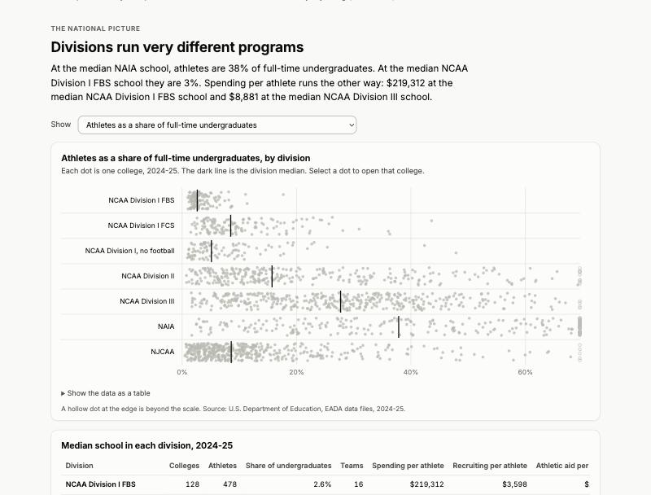

# Athletics Benchmarking Explorer

Pick any U.S. college and see how its athletics program compares with its conference, its division, or a group you choose. Built from public federal data with SQL and an AI coding agent. No college is featured: the page opens on a search box.



**Live page:** https://estetler-mbadba.github.io/athletics-benchmarking-explorer/

The same page is `docs/index.html` in this repository. It opens in a browser with no server or install.

This is an independent analysis of public records. It is not affiliated with or endorsed by any college, conference, or athletic association.

## The questions it answers

| Question | Where on the page | SQL |
|---|---|---|
| How large is the program for a college this size? | Athletes as a share of full-time undergraduates, ranked in the group | `mart_school_year` |
| What does the college spend per athlete, and on recruiting? | Standing table; ranked bars or a dot strip for any measure | `mart_school_year`, `mart_group_medians` |
| How much athletic aid does it award, set against its price? | Aid per athlete, aid as a share of tuition, full-cost scholarship equivalents | `mart_school_year` |
| Has it moved toward or away from its peers? | Four-year trend against the group median and middle half | `mart_group_medians` |
| Which sports are funded above or below the group? | Spending per participant by sport, against the group median | `mart_sport_school` |
| Is women's share of athletes in line with their share of students? | Proportionality gap, ranked in the group | `mart_school_year` |

A college can be compared with five groups: its conference, its division nationally, its division within its region, the 20 colleges in its division closest in enrollment, or a list built by hand. The college, group, and measure are stored in the page address, so a copied link opens the same view.

## What it demonstrates

| Skill | Where to look |
|---|---|
| SQL: joins, common table expressions, window functions, medians without a `MEDIAN()` function, a small dimensional model | [`sql/`](sql/) |
| Entity matching: 1,279 colleges matched from outside lists to federal IDs, with every exception documented | [`pipeline/conference_seed.py`](pipeline/conference_seed.py), [`data/seeds/`](data/seeds/) |
| Standard definitions and a data dictionary | [`DATA_DICTIONARY.md`](DATA_DICTIONARY.md) |
| AI-assisted development, with the AI's work checked | [`AI_WORKFLOW.md`](AI_WORKFLOW.md), [`pipeline/checks.py`](pipeline/checks.py) |
| An interactive page that is readable, colorblind-safe, keyboard-accessible, and works on a phone and in dark mode | [`docs/`](docs/) |
| Plain-language findings written from the data when the page loads | the explorer page |
| Tidy exports ready for Tableau, Power BI, or Excel | [`data/marts/`](data/marts/) |

## Rebuild it from the source files

```
make all
```

That runs four steps. Each can be run alone.

| Step | Command | What it does |
|---|---|---|
| Fetch | `make fetch` | Downloads four years of EADA files from the Department of Education and four small IPEDS files from NCES (about 50 MB, cached) |
| Load | `make load` | Reads the named columns from the Excel and CSV files into a SQLite database |
| Build | `make build` | Runs `sql/*.sql` and exports the marts as CSV and as one JavaScript file for the page |
| Check | `make check` | Runs 17 accuracy checks; exits with an error if any fail |

It needs Python 3.9 or later and nothing else. There are no packages to install and no accounts to create. EADA publishes Excel, SAS, and SPSS files but no CSV, so the project reads `.xlsx` with a small standard-library reader ([`pipeline/xlsx.py`](pipeline/xlsx.py)).

## How it is organized

```
pipeline/   fetch, load, build, and check (Python standard library only)
sql/        01 core model, 02 comparison groups, 03 marts
data/seeds  conference membership, hand corrections, and record cautions
data/marts  the finished tables, one CSV each
docs/       the explorer (static HTML, CSS, and JavaScript; hand-built SVG charts)
```

## Accuracy

The build is not trusted until every check passes. For every college in every year, sport expenses plus unallocated expenses equal the reported total, sport rosters equal the participant total, and aid by gender equals total aid. Every SQL median is recomputed in Python. Full-time undergraduate counts are compared with IPEDS fall enrollment: 83% of colleges are within 5% and 90% within 10%, which is the agreement to expect from two surveys that count on different dates. Every school on the conference lists is either matched to a federal ID or left out with a stated reason.

## Limits

- The federal file reports athletically related aid only. It cannot show academic or other institutional aid that athletes also receive, so it cannot measure the total discount to athletes.
- Figures are self-reported. Colleges differ in what they count as athletic aid, how they assign shared costs to teams, and how they count coaches.
- Revenue is not compared, because most small colleges report revenue equal to expense.
- Single-sex colleges, the service academies, and colleges that take no federal aid do not file and do not appear.
- Conference membership is for 2024-25 and comes from outside the federal file.
- Published prices for 2024-25 were not released at build time, so aid as a share of tuition sets 2024-25 aid against 2023-24 prices.
- A few records combine several athletic programs. They are shown with a caution and left out of group medians.

## Credits and license

Built by Eric Stetler with Claude Code, an AI coding agent. Data: U.S. Department of Education, Office of Postsecondary Education, Equity in Athletics Disclosure Act data files; National Center for Education Statistics, IPEDS. Conference membership is derived from Wikipedia's lists of NCAA and NAIA institutions and is available under CC BY-SA 4.0. Code is released under the MIT License.
